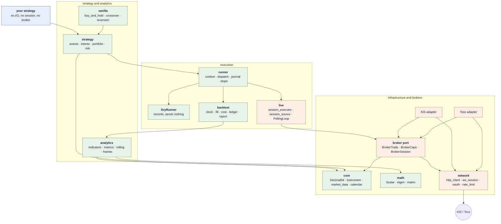

# algotradelib

C++17 building blocks for event-driven trading through Korean broker APIs — currently Korea
Investment & Securities (KIS) and Toss Securities.

Header-only, consumed through CMake. A strategy is a plain struct that performs no I/O and names no
broker, so one source is replayed against history, dry-run with no credentials, and then run live
against either broker without being rewritten. Selecting a broker is choosing a type parameter.

## Architecture



Green reaches no transport header and instantiates no adapter or TLS code — asserted at compile
time, not by convention, so there is no instantiated code path from a backtest to a market. It does
**not** mean libssl is off the link line; the package exports one interface target for every
consumer, as the prerequisites below explain. The
[architecture vignette](doxygen/vignettes/architecture.md) has the full picture, the dependency rule
underneath it, and what that compile-time claim does and does not cover.

## Prerequisites

| Dependency | Floor | Needed for |
| --- | --- | --- |
| A C++17 compiler | — | everything |
| CMake | 3.10 for the library, **3.16** for the project templates below | everything |
| Boost | 1.87, component `json` | everything |
| OpenSSL | **3.6.2** | everything (see below) |
| Eigen | 3.4 | the analytics layer, on by default |

Three of those floors are worth a sentence each.

**The two CMake numbers are not a typo.** The library itself configures under 3.10, so an existing
project on an old CMake can consume it. The consumer `CMakeLists.txt` shown below — and the one the
scaffold generates — ask for 3.16, which is simply a saner floor to start a new project on. Lower it
to 3.10 in your own project if you need to; nothing here requires the newer version.

**OpenSSL's is a patch-level minimum.** A machine carrying 3.5.x fails at configure time, and the
message names a version rather than a decision, so it reads like a mystery. If you hit it, that is
what happened.

**Boost and OpenSSL are required even for a backtest that touches no network.** The library exports
one interface target for every consumer, so an offline program still links `libssl`, `libcrypto` and
`boost_json`. That is measured, not assumed — inspecting a dry-run binary's dynamic dependencies
shows them. What is genuinely true is the narrower claim above: a dry run or a replay instantiates
no adapter and no transport code, asserted at compile time by `tests/test-runner-isolation.cpp`.

## Install

### The fastest start

```sh
tools/atl-new-project.sh my-alpha
```

That writes a complete project — `CMakeLists.txt`, `src/main.cpp`, `README.md`, `.gitignore` — whose
`main.cpp` is [`examples/example-backtest-compare.cpp`](examples/example-backtest-compare.cpp): your
own strategy replayed beside `BuyAndHold`, `SmaCrossover` and `DonchianBreakout` on identical bars.

```
  strategy                return     Sharpe     max dd  fills
  -----------------------------------------------------------
  MyStrategy(5)         -10.22 %     -0.375    13.11 %      2
  BuyAndHold             10.89 %      0.250    13.35 %      1
  SmaCrossover(3,8)       9.67 %      0.308     4.93 %      3
  DonchianBreakout(5)    12.17 %      0.383     4.82 %      3
```

It does not touch your git index — adding a submodule writes to your repository, and a script that
does that is one you cannot run twice — so it prints the command instead. `--mode package` generates
the installed-library variant, and `--help` lists the rest.

The generated project is built and run by this library's own test suite
(`tests/scaffold-smoke.sh`), which is the only reason to trust that the instructions below still
work.

### As a submodule

```sh
git submodule add https://github.com/ygeunkim/algotradelib.git libs/algotradelib
git submodule update --init --recursive
```

```cmake
cmake_minimum_required(VERSION 3.16)
project(my_alpha LANGUAGES CXX)
set(CMAKE_CXX_STANDARD 17)

add_subdirectory(libs/algotradelib)

add_executable(my_alpha src/main.cpp)
target_link_libraries(my_alpha PRIVATE algotradelib::algotradelib)
```

That is the whole of it. `ATL_BUILD_EXAMPLES` and `ATL_BUILD_TESTS` default to `OFF`, so a submodule
build compiles nothing but your own sources against the headers.

### As an installed package

```sh
cmake -S . -B build -DCMAKE_INSTALL_PREFIX=/your/prefix
cmake --build build --target install
```

```cmake
find_package(algotradelib REQUIRED)
target_link_libraries(my_alpha PRIVATE algotradelib::algotradelib)
```

Configure your project with `-DCMAKE_PREFIX_PATH=/your/prefix` if that is not a location CMake
already searches. The installed package config records whether the library was built with a backend,
so a consumer is never asked to restate how it was configured and cannot get it wrong.

### Build options

| Option | Default | Effect |
| --- | --- | --- |
| `ATL_USE_EIGEN` | `ON` | the analytics backend; see below |
| `ATL_BUILD_EXAMPLES` | `OFF` | the `example-*` programs in `examples/` |
| `ATL_BUILD_TESTS` | `OFF` | the Catch2 suite in `tests/` |
| `ATL_ENABLE_COVERAGE` | `OFF` | coverage instrumentation for that suite |

`ATL_USE_EIGEN=OFF` does not make analytics slower — it removes them.
`<algotradelib/analytics>` becomes a deliberate `#error` naming the option to set,
`backtest::summarize` and `backtest::Report` are gone, and `<algotradelib/vanilla>` ships only
`BuyAndHold` and `TimedLiquidation`, since every other vanilla computes an indicator. The replay
engine itself runs either way, so a build without a backend can still execute a strategy; it just
cannot score one.

To build and run the library's own checks:

```sh
cmake -S . -B build -DATL_BUILD_EXAMPLES=ON -DATL_BUILD_TESTS=ON
cmake --build build
ctest --test-dir build/tests --output-on-failure
```

## Using it

A strategy receives events and emits intents. It holds no session, so this same struct runs in all
three configurations below.

```cpp
#include <algotradelib/strategy>

using namespace algotradelib;

struct MyStrategy {
  template <class Ctx>
  void on_bar(Ctx& ctx, const strategy::BarEvent& bar) {
    strategy::TargetPosition target;
    target.instrument_ = bar.instrument_;
    target.target_quantity_ = Decimal64::parse("10");
    ctx.submit(target);          // state a position, not an order
  }
};
```

**Replay it against history.** `Backtester` is `Runner` with a replay clock and a fill model; the
fill never comes from the bar that produced the order, so the lookahead discipline is structural.

```cpp
#include <algotradelib/backtest>

backtest::Backtester<MyStrategy> engine(MyStrategy{}, config, fills);
for (const auto& bar : series.bars_) {
  engine.feed(strategy::make_bar_event(series.instrument_, series.interval_, series.stamp_, bar));
}
engine.finish();
const auto report = backtest::summarize(engine.result(), engine.fills(), periods_per_year);
```

**Run it live.** Binding a broker is choosing a type parameter; the loop owns the cadence, the stop
control, and the two gates that refuse to trade before the broker's own order list has been read.

```cpp
#include <algotradelib/live>

auto live_runner = live::bind(session, MyStrategy{}, limits);
live::SessionSource<Session> source(session, {samsung()});

runner::PollSchedule schedule;
schedule.bars_ = std::chrono::minutes(1);
schedule.holdings_ = std::chrono::seconds(30);

runner::PollingLoop loop(live_runner, source, schedule);
// Mandatory: state a maximum, or `allow_unbounded_portfolio_age()` to accept any. A run that
// states neither holds, because sizing against a portfolio nobody bounded is how this went wrong.
loop.set_maximum_portfolio_age(std::chrono::minutes(2));

runner::StopSource stop;
runner::SignalStop::install(stop);
const auto report = loop.run(stop);
```

Bars reach a replay either from a broker (`example-backtest-broker` fetches real history through KIS
or Toss) or from `Bar` values you construct yourself. This library reads no files on purpose: parsing
somebody's CSV is not a thing it can do honestly for everyone, and it belongs in your project where
its assumptions are yours.

Seven of the programs in `examples/` need no credentials, no network and no broker at all, and are
the fastest way to see each layer work: `example-strategy-dryrun`, `example-backtest-offline`,
`example-backtest-compare`, `example-live-loop`, `example-order-journal`,
`example-analytics-offline` and `example-rate-limit-stats`. `example-kis-place-order` is offline too
— it constructs and prints an `OrderRequest` and can send nothing. The rest read credentials from
the environment; the [broker clients](doxygen/vignettes/broker-clients.md) page lists which.

## Documentation

The [user guide](doxygen/vignettes/guide.md) is eleven pages in the order they are worth reading:

| | Page | What it answers |
| --- | --- | --- |
| 1 | [Architecture](doxygen/vignettes/architecture.md) | what the pieces are, and why the strategy holds no session |
| 2 | [Writing a strategy](doxygen/vignettes/writing-a-strategy.md) | the handlers, warm-up, prices, reaching a broker-specific feature |
| 3 | [Binding a broker](doxygen/vignettes/binding-a-broker.md) | the limits, how finely a target is chased, what killing the process does |
| 4 | [Market data](doxygen/vignettes/market-data.md) | bars and paging, the stamp conventions, the price grid, the calendar |
| 5 | [Analytics conventions](doxygen/vignettes/analytics-conventions.md) | two numeric types, two kinds of absence, the smoothing constants |
| 6 | [Reading a backtest honestly](doxygen/vignettes/reading-a-backtest.md) | what the fill model assumes, and what to distrust first |
| 7 | [Running a strategy live](doxygen/vignettes/running-a-strategy-live.md) | the three stops, the gates, the supervisor grace period |
| 8 | [Recovering after a crash](doxygen/vignettes/recovering-after-a-crash.md) | the journal, the five verdicts, reading them under pressure |
| 9 | [The broker port](doxygen/vignettes/the-broker-port.md) | `BrokerTraits`, `BrokerCaps`, order identity — read this to add a broker |
| 10 | [Talking to a broker directly](doxygen/vignettes/broker-clients.md) | the KIS and Toss clients, and the order-safety rules |
| 11 | [Transport and request pacing](doxygen/vignettes/transport-and-pacing.md) | the pacer, the traffic classes, how each broker reports a refusal |
