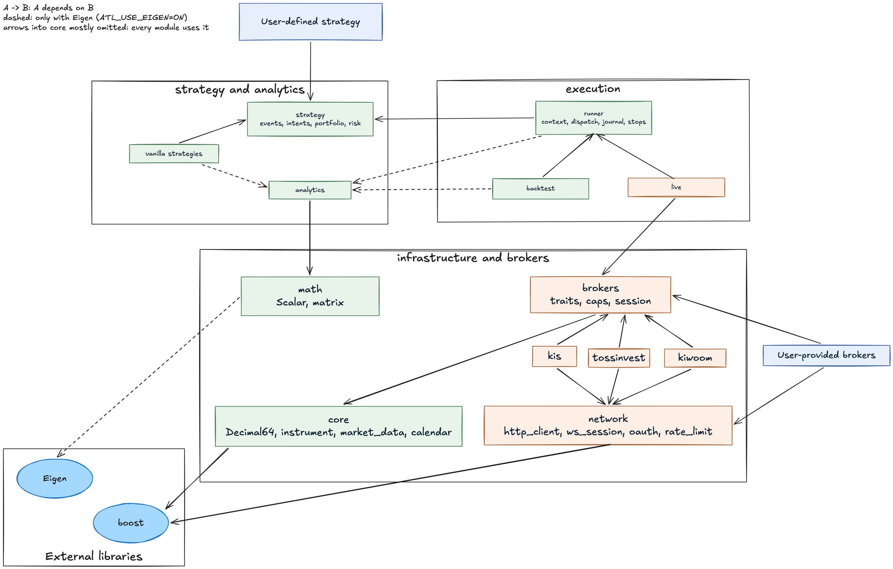

# algotradelib

<!-- badges: start -->

[](https://lifecycle.r-lib.org/articles/stages.html#experimental)
<!-- badges: end -->

<!-- multilingual: start -->
[](README.md)
[](README.ko-kr.md)
<!-- multilingual: end -->

A C++ library for algorithmic trading through Korean broker APIs
— currently Korea Investment & Securities (KIS), Kiwoom Securities and Toss Securities.

Header-only, consumed through CMake.
A strategy is a plain struct that performs no I/O and names no broker, so one source is replayed against history, dry-run with no credentials, and then run live without being rewritten.
Selecting a broker is choosing a type parameter.

> **This library sends real orders to real accounts.**
> It has placed orders on KIS and Kiwoom demo accounts, but has not yet run end to end on a real account.
> It is in development (`0.0.0.9000`, no release yet).
> Rehearse on a demo account first, and read "Brokers and accounts" and the Disclaimer below before you do.



Blue is what you bring; orange carries the transport.
Green reaches no transport header and instantiates no adapter or TLS code
— asserted at compile time, so there is no instantiated code path from a backtest to a market.
The [architecture page](doxygen/vignettes/architecture.md) explains the rule and what it does not cover.

## Install

Requires a C++17 compiler, CMake 3.10, Boost 1.87 (`json`), OpenSSL 3.0 and,
for the analytics layer (on by default), Eigen 3.4.
Boost and OpenSSL are linked even by a program that never touches the network.
Use a supported OpenSSL line (3.5 LTS or newer) for anything that trades.

As a submodule:

```sh
git submodule add https://github.com/ygeunkim/algotradelib.git libs/algotradelib
git submodule update --init --recursive
```

```cmake
cmake_minimum_required(VERSION 3.16)
project(my_alpha LANGUAGES CXX)
set(CMAKE_CXX_STANDARD 17)

add_subdirectory(libs/algotradelib)

add_executable(my_alpha src/main.cpp)
target_link_libraries(my_alpha PRIVATE algotradelib::algotradelib)
```

It also installs as a CMake package (`find_package(algotradelib)`).
The [documentation main page](doxygen/index.md) covers that, the build options and the version macros.

## Using it

A strategy receives events and emits intents.
It holds no session, so the same struct is replayed, dry-run and run live.

```cpp
#include <algotradelib/strategy>

using namespace algotradelib;

struct MyStrategy {
  template <class Ctx>
  void on_bar(Ctx& ctx, const strategy::BarEvent& bar) {
    strategy::TargetPosition target;
    target.instrument_ = bar.instrument_;
    target.target_quantity_ = Decimal64::parse("10");
    ctx.submit(target); // state a position, not an order
  }
};
```

[`examples/example-backtest-compare.cpp`](examples/example-backtest-compare.cpp) replays a strategy against history, offline.
To run one live, copy [`examples/example-live-program.cpp`](examples/example-live-program.cpp)
and [`examples/live_program.hpp`](examples/live_program.hpp) and replace the strategy with yours:

```sh
cmake -S . -B build -DATL_BUILD_EXAMPLES=ON
cmake --build build
export KIS_APP_KEY=... KIS_APP_SECRET=... KIS_CANO=... KIS_DEMO=1
./build/bin/example-live-program kis 005930 # observe: real data, nothing can be sent
./build/bin/example-live-program kis 005930 --live # trade, through a journal
```

A KIS demo host refuses reference data,
so on demo these stop there unless market data comes from elsewhere;
the header of `examples/example-live-program.cpp` explains how, and how it reads credential files.
The [main page](doxygen/index.md#using-it) walks through the program, its credential files and its exit codes.
Before `--live`, read [Running a strategy live](doxygen/vignettes/running-a-strategy-live.md): how a run stops, and what it refuses to send.

## Brokers and accounts

| Broker | State | Paper trading |
| --- | --- | --- |
| KIS | market data, calendar, reference data, holdings, buying power, orders (including stop-limit), order history | default (`KIS_DEMO=0` for live) |
| Kiwoom | market data, reference data, buying power, orders (including stop-limit), order history; **no calendar**; holdings and strategy orders need settings first | default (`KIWOOM_DEMO=0` for live) |
| Toss | market data, calendar, reference data, holdings, buying power, orders (no stop-limit), order history | **none** |

- **KIS and Kiwoom are demo unless you say live** (`KIS_DEMO=0`, `KIWOOM_DEMO=0`, or `"demo": false` in a credential file). Demo endpoints refuse live keys, so a forgotten setting fails instead of trading.
- **Toss has no paper-trading environment.** A Toss program with credentials trades real money.
- **Kiwoom places nothing as shipped.** Its holdings inquiry and its strategy orders refuse until you state what the inquiry covers and which venue orders go to, and with no calendar the default limits open no position.
- **SOR (`Venue::COMBINED`) is opt-in**, and KRX or NXT is the safer choice until SOR has been seen on an account.

The [main page](doxygen/index.md#brokers-and-accounts) has the details of each.

## Documentation

The [user guide](doxygen/vignettes/guide.md) is eleven pages, from writing a strategy to recovering after a crash.
With Doxygen installed, the guide and the API reference build into HTML:

```sh
cmake --build build --target docs # doxygen/docs/html/index.html
```

## Acknowledgements

This project was developed with the assistance of generative AI tools.

## Disclaimer

algotradelib is released under the MIT license; see [LICENSE](LICENSE). The software is provided as
is, without warranty of any kind, and the authors are not liable for any loss, including trading
losses, arising from its use. Nothing in this repository is investment advice.
