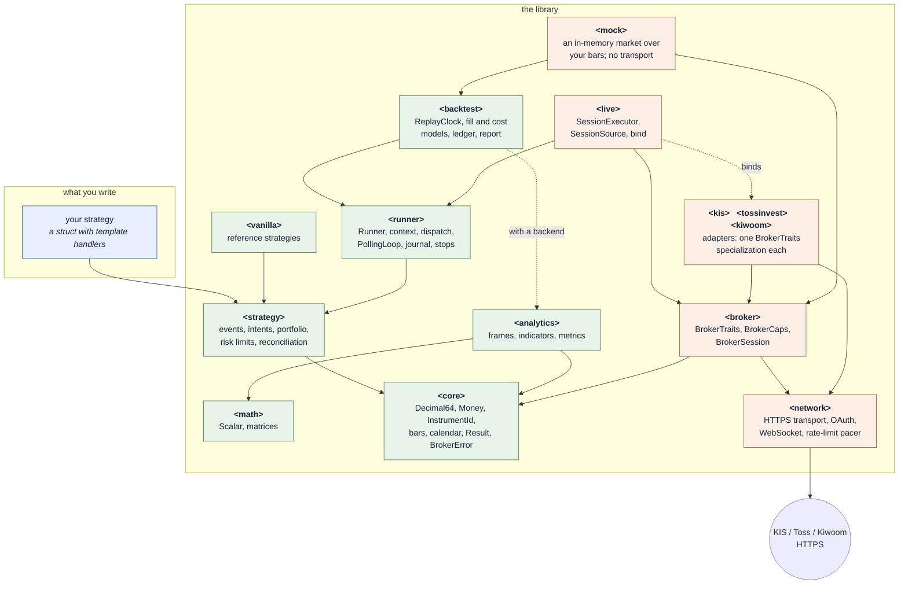
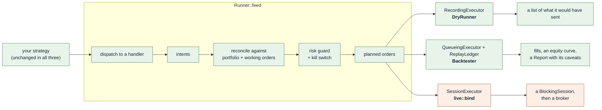
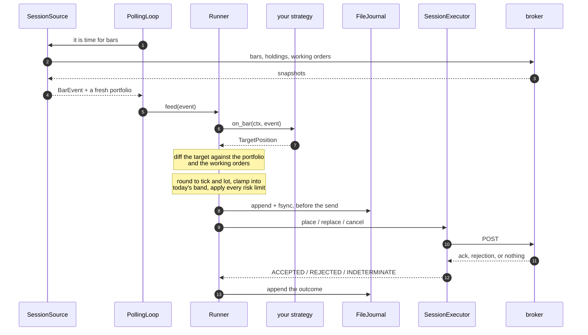
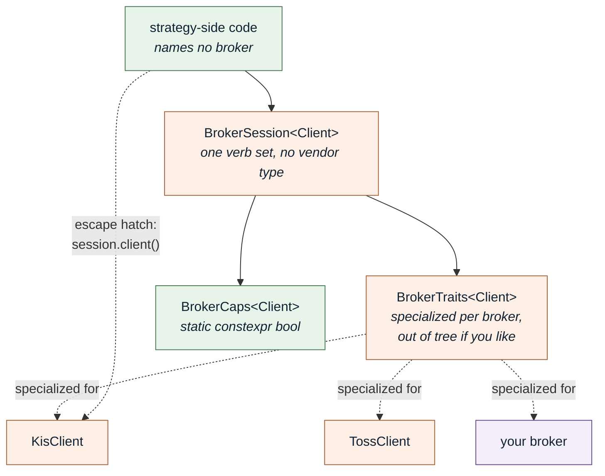
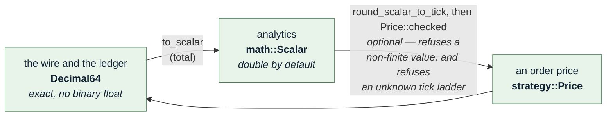

# Architecture {#architecture}

One sentence, and the rest of this page is the argument for it: **a strategy is pure, a broker is a
type parameter, and the runner is the only thing that touches both.**

Everything else follows. A strategy that holds no session can be replayed against history without
faking a transport, so a backtest exercises the same source a live account does. A broker that is a
type parameter rather than a virtual base costs nothing at run time and turns "you handed a KIS
reference to a Toss session" into a compile error. And a runner that is the only component holding
both is the only place the order-safety rules have to be written.

## The layers

Green is I/O-free. Orange is the broker side; its HTTP and TLS code is in `<network>` and the adapters,
which `<algotradelib/broker>` and `<algotradelib/live>` reach only as far as the rate-limit header. The
green boundary is not a convention — it is asserted
at compile time by two translation units that include exactly one umbrella header each and
`#error` if a transport or adapter macro is visible:
`tests/test-strategy-isolation.cpp` for `<algotradelib/strategy>`, and
`tests/test-runner-isolation.cpp` for `<algotradelib/runner>`. A third,
`tests/test-broker-isolation.cpp`, holds `<algotradelib/broker>` to a narrower line: Asio and the
network module's rate-limit types, but no Beast and no OpenSSL. A fourth,
`tests/test-mock-isolation.cpp`, holds `<algotradelib/mock>` to the same line: the mock broker reaches
no HTTP, WebSocket or TLS code.

What that assertion does and does not claim is worth being exact about. It establishes that a dry-run
or replay translation unit **instantiates** no adapter and no transport code, so there is no
instantiated code path from a backtest to a market. It does not claim libssl is off the link line:
the package exports one interface target for every consumer, so an offline binary carries the
dependency it never calls; the library does not have a transport-free target yet.

Two other edges are worth reading off the picture:

- **`<core>` does not include `<network>`.** `BrokerSession` includes one header of it, the
  rate-limit statistics (`network/rate_limit.hpp`), which is why it ships under
  `<algotradelib/broker>` rather than being reachable from the value types. HTTP, WebSocket and
  TLS come with an adapter (`<algotradelib/kis>` and the others), not with the session. A program
  that only parses bars therefore compiles no transport code — though it still *links* libssl,
  because the package exports one interface target for every consumer. The paragraph above is the
  exact claim.
- **`<analytics>` is the only layer that *implements* against a linear-algebra backend**, and it is
  optional — but turning it off reaches further than that one box. With `ATL_USE_EIGEN=OFF`,
  `<algotradelib/analytics>` is a deliberate `#error` naming the option, `backtest::summarize` and
  `backtest::Report` are gone, and `<algotradelib/vanilla>` ships only `BuyAndHold` and
  `TimedLiquidation`, because every other vanilla sits in a header that needs
  `<algotradelib/analytics>`. The replay engine itself still runs, so such a build can execute a
  strategy; it cannot score one.

## The dependency rule, and the rule underneath it

An adapter must not expose vendor types to the strategy layer. That is the rule most libraries state,
and on its own it is not enough here. The one underneath it is about *values*:

> **Core is broker-neutral in its values, not only in its types.** A closed `enum class` in `core/`
> whose members name one country's venues or sessions satisfies "no vendor types" and still breaks
> the layering, because the leak is in the enumerators.

The test is not "does this cover the brokers we have" but **"could someone add a broker for another
country, in their own project, without editing this library?"** `BrokerTraits` is already
specializable out of tree; the vocabulary has to be extensible the same way. Where it is not yet —
`Venue` enumerates one country's market structure — that is a known gap rather than a
settled design.

`Code<N>` is the fixed-capacity, allocation-free preservation type that exists for this: a code the
library does not recognize is carried verbatim beside the normalized enums rather than discarded —
**as far as it fits.** `Code<N>` holds at most `N` characters from `A`-`Z`, `0`-`9` and `_`, and a
code outside that alphabet or over that length is not stored, which is why every field built on it
documents an empty value as meaning either "nothing was sent" or "what was sent would not fit".

## One `Runner`, three configurations

`Runner::feed` is the whole engine. What changes between a dry run, a backtest and a live session is
the **executor** it sends through and the **clock** it reads — not the strategy, and not the
reconciliation, the risk guard or the order-safety rules.

The consequence that pays for the whole design: `NextBarFillModel::decide` takes the *next* bar and
nothing else, so a backtest cannot see the signal's own bar. The lookahead discipline is structural
rather than a rule to remember — and because the strategy source is byte-identical across the three
columns, what the replay scored is what the live loop runs.

`PollingLoop` wraps the live column with a cadence, a stop control and two gates. It is not a fourth
configuration; it calls the same `feed`.

## What happens to one bar

The executor's answer — `ACCEPTED`, `REJECTED` or `INDETERMINATE` — is the step the rest of the
library is arranged around. A POST that fails **in transit** is
not a failure — it is an *unknown*, because the order may or may not have reached the broker. The
runner never retries it. It marks the instrument in the indeterminacy ledger and withholds everything
further for that instrument until the broker's own order list has been read, because a retry is
exactly what doubles a position.

The `append + fsync` before the send is why the journal exists. The record is appended, flushed and `fsync`ed **before** the send
is attempted, so it exists during the exact window in which the process may vanish. An in-memory
ledger cannot survive a `SIGKILL`, and an empty ledger after a restart means *nothing is remembered*,
not that nothing is owed.

## Binding a broker

An adapter is a `BrokerTraits<Client>` specialization: associated types, `static constexpr bool`
capability flags, one-line call thunks, and pure normalizers. It is **non-intrusive** — the client
class does not inherit anything — and it lives in the adapter's own directory.

Core headers include no broker header, and adding a broker edits no shared file:
`tests/mock_broker.hpp` adds a broker of its own entirely within itself, which is the only evidence worth
having for that claim. `ATL_ASSERT_BROKER(Client)`, asserted once in the adapter's own tests, compiles
every verb the capabilities claim and reads every capability constant (see
[the broker port](the-broker-port.md)). These checks are for safety at build time, not for speed: they
generate no code, and what is fast at run time is the static dispatch they check.

Three consequences that come up constantly:

- **Capability is compile time; availability is run time.** Whether a broker *implements* a verb is a
  `BrokerCaps` constant you gate on with `if constexpr`. Whether *this credential* may call it is a
  run-time matter — KIS does not serve its amendable-order inquiry to demo accounts, so there the
  adapter answers it from the daily order inquiry, and encoding that as a compile-time capability
  would make one binary claim different things for a live and a demo key.
- **Order identity is a template parameter, not a stored field.** `OrderRef<Broker>` handed to the
  wrong session fails to compile. No comparison happens on any amendment path.
- **The escape hatch is visible in the source.** `session.client()` returns the concrete client, so
  using one broker's particular strength is something you can grep for, never something that happens
  by accident.

## Normalize the intersection, expose the difference

Brokers do not publish the same information, and that is not a problem to be solved by normalization.

- A value the brokers genuinely mean the same way becomes a shared type. *Genuinely* is load-bearing:
  two fields with similar names that mean different things are not one thing, they are two.
- A capability only one broker has stays that broker's, reachable through `BrokerCaps` and
  `session.client()`. It is neither hidden nor faked on the broker that lacks it.
- A caller then chooses: the common core and run anywhere, or a capability gate and one broker's
  strength, or both.

What this rules out is the tempting middle: a normalized model for something only one broker reports,
so the shared type carries a field that is always empty for the other; or a synthesized value the
broker never sent — resampling bars to fake an interval, deriving a session window from a holiday
list. Both produce a surface that looks portable and is not. An interval a broker does not publish is
**refused**, never aggregated from a shorter one.

The same instinct is why nothing is ever silently downgraded. A condition the caller stated is either
honored or rejected with `INVALID_ARGUMENT` before any authentication and before any socket write —
never quietly approximated, because a downgrade changes when and at what price an order executes.

## Two numeric worlds, one gated boundary

Prices, quantities and money stay in `Decimal64` anywhere they cross the wire or are reconciled,
because binary floating point cannot hold them exactly and a reconciliation compares for equality.
Analytics needs a float, so it gets one — and the two meet at three named, tested functions in
`analytics/conversion.hpp`: `to_scalar` one way, and `to_decimal` (for a computed quantity or weight) and
`round_scalar_to_tick` (for a price, whose result still goes through `Price::checked`) back.

**The return path is the narrow one.** `strategy::Price` has no public constructor. The only routes in
validate against the instrument's `PriceRule`, so an indicator value cannot reach the wire as an
off-tick limit price. An instrument whose ladder the library does not know gets *no answer* rather
than a guess, because attaching the equity grid to an ETF would round onto a ladder the exchange does
not use and the order would be rejected — with the library having confidently produced the price.

That is also why the tick rule lives in market data rather than in the strategy layer, and why
`PriceRule` records its own `source_`: no adapter builds the grid from a broker's reply (a broker
states at most the tick at one price), so the table is this library's own and a stale one has to be
visible rather than assumed.

## Where to go next

- [Writing a strategy](writing-a-strategy.md) — the surface you actually write against.
- [The broker port](the-broker-port.md) — `BrokerTraits`, `BrokerCaps`, and the capability table.
- [Binding a broker](binding-a-broker.md) — putting a session behind a running strategy.
- [Reading a backtest honestly](reading-a-backtest.md) — what the replay does and does not model.
